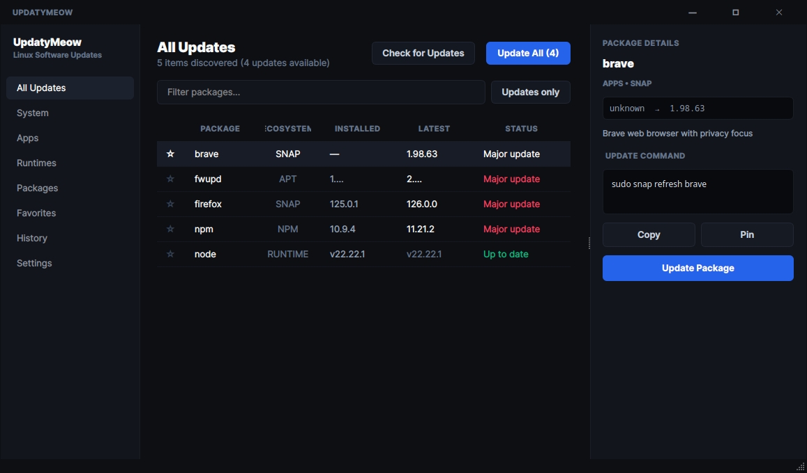

<p align="center">
  
</p>

# UpdatyMeow 🐱

### Every update on your Linux machine. One window.

Inspired by [UpdatyMe](https://github.com/DanielFiller30/UpdatyMe) for macOS, **UpdatyMeow** brings the unified, single-window update experience to the Linux desktop.

APT, Flatpak, Snap, Python packages, global NPM tools, and developer runtimes — UpdatyMeow discovers what you have installed, tells you what's outdated, and updates it when *you* say so.

<p align="center">
  
</p>

---

## ✨ Features

- 🔍 **One Unified Inventory**: Scans across your entire system in parallel:
  - **System**: Debian/Ubuntu APT packages & firmware
  - **Apps**: Flatpaks and Snaps
  - **Packages**: Global `npm` and Python `pip` packages
  - **Runtimes**: Node.js, Python, uv, Rust
- 🛡️ **You Stay in Control**:
  - Transparent command previews for every update
  - Copy command to clipboard with one click
  - Live streamed output in an update console
- 📌 **Pin & Favorite**:
  - Pin packages to suppress update alerts
  - Star favorite packages for rapid access
- ⚡ **Update One or All**:
  - Update selected packages or hit **Update All**
- 🕒 **History**:
  - Tracks update runs with timestamps, versions, and execution logs
- 🔔 **Quietly in the Background**:
  - System tray icon with pending updates count badge
  - Native desktop notifications when new updates are found or finished
  - Automatic scheduled checks (every 6h, 12h, daily, or weekly)
  - Launch at login (autostart)
- 🧩 **Extensible without Code**:
  - Add custom tools to `~/.config/updatymeow/tools.json`
- 💻 **CLI & GUI Modes**:
  - Launch full desktop GUI or run `updatymeow --check` in terminal / cron scripts

---

## 🚀 Installation & Getting Started

### Standalone AppImage (Universal Linux)

Download the self-contained, portable AppImage from [GitHub Releases](https://github.com/emacholdt/updatymeow/releases):

```bash
chmod +x UpdatyMeow-*-x86_64.AppImage
./UpdatyMeow-*-x86_64.AppImage
```

To build the AppImage locally yourself:
```bash
./build_appimage.sh
```

### Native Script Install

#### Prerequisites
- Python 3.10+
- PyQt5 (`sudo apt install python3-pyqt5`)

```bash
git clone https://github.com/emacholdt/updatymeow.git
cd updatymeow
./install.sh
```

This installs `updatymeow` into `~/.local/bin/` and sets up the desktop launcher in `~/.local/share/applications/` without hardcoded paths.

To uninstall anytime:
```bash
./uninstall.sh
```

### Usage

- **GUI**: Launch `updatymeow` from your terminal or application launcher.
- **Terminal Check**: Run `updatymeow --check` to quickly list pending updates without opening a window.
- **Autostart Mode**: Run `updatymeow --minimized` to start directly in the system tray.

---

## 🧪 Testing

UpdatyMeow is built with Test-Driven Development (TDD) using standard library `unittest`:

```bash
python3 -m unittest discover tests
```

---

## 📄 License

MIT License. Inspired by [Daniel Filler's UpdatyMe](https://github.com/DanielFiller30/UpdatyMe).

